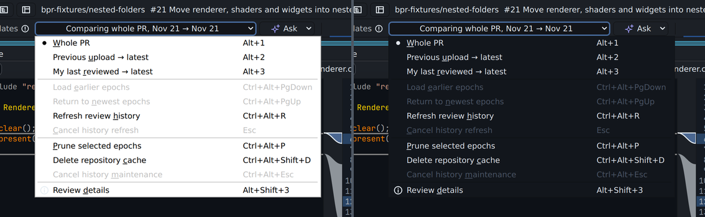

# Revision and Ask menus can open light with Appearance set to Dark

With BetterPullReview explicitly set to Dark, the Review workbench stayed dark on a light desktop, but the revision dropdown and the adjacent Ask menu opened with a white background and dark text. Running the same executable and profile with a dark desktop palette produced dark menus. The matching desktop and app settings hide this bug.

## Reproduce

1. Run the [released Linux build 76](https://github.com/MikeMarcin/BetterPullReview/releases/tag/0.5.0) with a light desktop palette. Set **Settings → Appearance** to **Dark**.
2. Open a pull request and switch to **Review**. Open the comparison dropdown above the diff. Dismiss it and open **Ask**.
3. Compare the background and text of both menus with the surrounding workbench.
4. Keep the same app profile and switch the desktop palette to dark. Relaunch and open the same menus again.

The release executable ran on an isolated Ubuntu 26.04 X11 display. The first capture used Qt's default light desktop palette. The second used a dark KDE palette. Both captures used the same pull request and the same explicit app appearance. This reproduces a dependency on the platform palette. A live palette change within one running process and the other platforms still need coverage.

## Expected behavior and acceptance

- **Dark** and **Light** each use the selected app theme for the workbench and its in-app popup menus, including their normal, selected and disabled items. A desktop theme change during the session preserves that choice when a menu is reopened.
- **System** resolves the app theme from the desktop appearance and applies it consistently to menus and the underlying workbench.
- Exercise both menus with explicit Dark on a light desktop and explicit Light on a dark desktop. Exercise System with each desktop appearance and after switching it. Include a check that opens the real popup, since a check limited to the parent widget misses the reported failure.

The [appearance contract](../../rfcs/RFC-BPR-0006-syntax-highlighting-themes-appearance.md) already specifies that only System responds to OS scheme changes.
