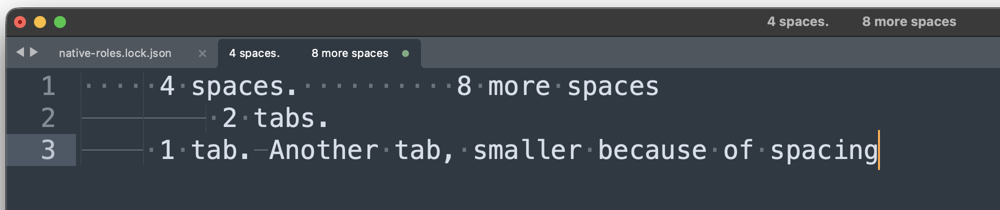

# BPR-1107: Draw white space the Sublime Text way, dots for spaces and lines for tabs, with a setting for when

## Why

[[BPR-0986]] made the review panes paint the Appearance preview's tab markers
on every leading tab (`55e9405f`). On 2026-09-24 the owner rejected that
rendering in attended session `cbd48b91000b00f1e72e1ad62c7c384c` (packet
[owner-decisions-20260924-v001](../../verification/reviews/owner-decisions-20260924-v001/operator-packet.md),
candidate `BPR-0986-rendered-panes-v001`, revision `55e9405f`, fingerprint
`5b87471b…`, decision `6b7243c3-f194-4396-a3b9-0f8309dabfcf`, sequence 580,
19:12:17Z, `actor: human`): **reject**, with this note, verbatim:

> Should follow the sublime text model with dots and lines and have settings to control white space. We don't need to support all their settings but at least easy and impactful ones.

The rest of the note is Sublime Text's own documentation of its
`draw_white_space` setting, pasted verbatim (tabs as the owner pasted them;
trailing blank lines omitted):

```text
	// Controls when white space is drawn. Any of the following options may be
	// combined:
	// - "selection": Draw white space under the current selection.
	// - "leading": Draw any white space between the beginning of a line and the
	//              first character.
	// - "enclosed": Draw white space enclosed by other characters.
	// - "trailing": Draw white space following the last character on a line.
	// - "isolated": Draw white space on lines containing no other characters.
	// - "all": All of the above, ie. always draw white space.
	//
	// These options may be further refined by appending any of the following
	// separated by an underscore:
	// - "none": Don't draw this kind of white space.
	// - "tabs": Only draw tabs here.
	// - "spaces": Only draw spaces here.
	// - "mixed": Only draw white space that does not match the indentation
	//            style. For example if "translate_tabs_to_spaces" is true only
	//            draw tabs.
	// - "mixed_tabs": Like "mixed" but only draw tabs.
	// - "mixed_spaces": Like "mixed" but only draw spaces.
	// - "all": Draw both tabs and spaces. This is the default.
	//
	// Note that options are applied in sequence. So a later option may override
	// an earlier one.
	//
	// Examples:
	// - ["selection", "trailing", "isolated"]:
	//     Draw white space at the end of any lines and under the selection.
	//
	// - ["all_tabs", "selection"]:
	//     Draw tabs anywhere and any white space under the selection.
	//
	// - ["all_mixed"]:
	//     Draw any white space that does not match the indentation style.
	//
	// - ["leading_mixed", "isolated_mixed"]:
	//     Draw any indentation that does not match the indentation style.
	//
	// - ["selection_mixed_tabs"]:
	//     Draw only tabs under the selection and only if the indentation style
	//     is spaces.
	//
	// - ["all_tabs", "selection"]:
	//     Draw all tabs and any white space under the selection.
	//
	// - ["all", "selection_none"]:
	//     Inverse of the default. Draw white space everywhere except under the
	//     selection.
	"draw_white_space": ["selection"],
```

He attached a Sublime Text window as the reference, kept here cropped to its
text (the full 3648x2216 original, SHA-256
`192322df1f0049d75f671ddaddc0ebd4c597ddfd0b164953fbaf805339e40616`, stays in
the session's decision record):



In it every space, leading, enclosed or trailing, is a small centred dot. Each
tab is a thin horizontal line running from where the tab starts to its tab
stop, so a tab that begins mid-stop is shorter ("Another tab, smaller because
of spacing"). Faint vertical guides mark the indentation stops. The editor's
status bar reads "Tab Size: 4".

## Scope

- **Draw.** In the review panes (both panes and one pane), draw a space as a
  dot and a tab as a line to its tab stop, in the white-space colour, at the
  pane's own tab width. The Appearance page's preview draws the same thing
  through the same painter. RFC-BPR-0034 C4 makes the preview "the review
  window's painter in miniature", and the shared helper stays the only
  renderer. It replaces `paint_tab_markers`' current leading-tab markers.
- **When.** A setting chooses when white space is drawn. At least the easy and
  impactful choices from the owner's list: none, selection, leading,
  trailing, and all. Consider enclosed, isolated and the tabs-only,
  spaces-only and mixed refinements, and include the ones that are cheap. Say
  which are left out and why. The default is proposed with the design and
  confirmed by the owner.
- **Where the setting lives.** On the Appearance page's Type card beside Tab
  width, as one more one-line row with an info glyph, in RFC-BPR-0034's row
  language. It is persisted with the typography, per profile, through the
  existing appearance store. A schema change is a migration with a test.
- **The colour.** Reuse the role the markers use today
  (`code_line_number_text`), unless the design shows it fails on some theme.
  A new role is an RFC-BPR-0006 decision, and this card does not take it.
- **Line identity is untouched.** Drawing white space changes no text, no
  selection, no copy and no line mapping.

## Acceptance

- AC1 A design page shows the drawing and the setting on the four themes, with
  the owner's reference beside it, rendered and inspected headless.
- AC2 The review panes and the preview draw spaces as dots and tabs as lines to
  their stop, through one shared painter, for each setting value offered.
  `qt_diff_workbench_scale_100/125/200`, `qt_code_sample_painter`,
  `qt_type_preview` and `qt_theme_preview_strip` pin it, and each fails with
  the drawing switched off.
- AC3 The setting is a live control on the Appearance page and persists.
  `qt_appearance_settings_panel`, `qt_appearance_profile`,
  `sqlite_appearance_settings_storage` and the appearance end-to-end contracts
  pass.
- AC4 The owner accepts the rendered drawing and the setting in an attended
  session: one question for the drawing and one for the setting's choices and
  default.

## Boundaries

The core decides, the host performs, Qt presents. The setting is appearance
state owned by the appearance domain. The painter only reads it. No
stylesheet and no hard-coded palette. [[BPR-0986]] keeps the current-line band
and the two hunk-header roles; this card owns white space.

## Built, 2026-09-24 (Mac batch 7)

**The drawing.** `paint_white_space` in `code_sample_painter` replaces
`paint_tab_markers`. It is now the only white space renderer.
- A space is a small dot at the middle of its cell.
- A tab is a thin line from where it starts to its tab stop, a hair short of
  each end, so a tab that begins partway to a stop is shorter.
- Both use `code_line_number_text` at the old markers' faint alpha. No new
  role is added (the RFC-BPR-0006 boundary holds).

Three surfaces draw through it:
- the review panes (both panes and one pane) and the Appearance preview,
  through `paint_white_space_of_block`, which places each mark where the
  editor put the character (`cursorRect`), so the tab stops are the editor's
  own;
- the theme tiles, through `paint_code_sample`.

A line is under the selection when the pane's selection wash holds it: the
two panes pass their washed lines, and the one pane its unified selection.

**Which characters: the core decides.** `core::white_space_drawn`
(`src/core/src/white_space.cpp`) takes one line's characters, classified as
space, tab or other, plus the choice and whether the line is selected. It
answers which characters are drawn. Leading and trailing are measured from the
first and last other character, and a line of white space alone is both.

**The setting.** `core::white_space_drawing`, carried on
`code_font_settings::WhiteSpace`, has six choices:

| Choice | Sublime Text | Draws |
|---|---|---|
| None | `[]` | nothing |
| Under the selection (default) | `["selection"]`, Sublime's default | every white space character on a selected line |
| Leading | `["leading"]` | indentation |
| Trailing | `["trailing"]` | from the last other character to the end |
| Leading and trailing | `["leading", "trailing"]` | both, so also a line of white space alone (Sublime's "isolated") |
| All | `["all"]` | everything, enclosed white space too |

- **Where it lives.** `validate_typography` refuses a value outside the
  vocabulary (`typography_field::white_space`). The Type card gains a row,
  **White space**, directly beneath Tab width: a one-line row with an info
  glyph and a choice, dispatched as the typography intent the other rows use.
- **Where it persists.** The appearance store is now schema **version 8**. It
  adds `code_white_space INTEGER NOT NULL CHECK(... BETWEEN 0 AND 5)`. A
  version-7 file is carried across a fresh table and takes the fresh default.
  A value written past the CHECK is refused whole on load.
- **Who reads it.** The panes read it from the profile's typography in
  `diff_workbench::adopt_appearance`, the preview from its adopted
  typography, and the tiles from the panel. The preview's caption states the
  choice.
- **The RFC.** RFC-BPR-0034's Type paragraph and C3 now say twelve rows, with
  a dated note that does not reopen C1 to C6.

**Left out, and why** (also on the design page):
- Combining choices: one at a time keeps the row one line. Leading and
  trailing is the one combination with its own entry.
- Enclosed and isolated on their own: enclosed alone answers nothing All does
  not, and isolated is already drawn by the leading and trailing choices.
- The `_tabs`, `_spaces` and `_none` refinements would triple the list.
- The `_mixed` refinements need an indentation style the review window does
  not have.
- Indentation guides are a separate Sublime setting and are not white space.

**AC1, the design page.**
[BPR-1107-white-space-v1.html](../../design/BPR-1107-white-space-v1.html) shows:
- the owner's reference beside the panes;
- the panes in all four themes;
- the Type card in all four themes;
- each choice in Light and Dark;
- the proposed default and what is left out.

Every picture is a real capture, written by gated courses:
`BPR_WHITE_SPACE_CAPTURE_DIR` runs `test_white_space_design_captures` in
`qt_diff_workbench_scale_200` and `test_white_space_row_design_captures` in
`qt_appearance_settings_panel`. The captures are stored under
`docs/verification/BPR-1107-white-space-drawing/`. The page was rendered
headless with Chrome (`--headless=new --screenshot`) at 1360 px and
inspected: every image loads and the four themes read. The offscreen host
resolves the code font to a proportional face. The page says so, because the
marks follow whatever font is in effect.

**Verification** (macOS 26.6.2 arm64, `build/dev`):
- `core_appearance_policy` has two new tests.
  `test_white_space_drawing_follows_the_choice` covers each choice on the
  reference's first line, tabs, a line of white space alone, empty and
  white-space-free lines, and an out-of-vocabulary value.
  `test_white_space_vocabulary_is_closed` covers names, the default, bounds
  and the malformed refusal.
- `qt_code_sample_painter`:
  - `test_white_space_is_dots_and_lines_to_the_stop` reads pixels: a tab's
    line at the row's middle, a space's dot, and a partial tab ending at its
    stop;
  - `test_each_choice_draws_the_white_space_it_names` covers each choice on a
    painted sample, and an editor line through `paint_white_space_of_block`.
- `qt_type_preview` counts 5 under the selection (the selected row's two tabs
  and three spaces), 5 for leading, 21 for all and 0 for none, and the caption
  states the choice.
- `qt_theme_preview_strip`: all draws on the tiles; none and under the
  selection do not (the tile snippet selects nothing).
- `qt_diff_workbench_scale_100/125/200` count:
  - 12 for leading (six indenting tabs a side);
  - 32 for all;
  - 0 for trailing;
  - 2 under the selection (the selected change's two spaces);
  - 0 for none.
- `qt_appearance_settings_panel`: `test_white_space_is_a_row_beside_tab_width`
  checks the six items in order with their labels, that adoption shows the
  choice without dispatching, that the row sits beneath Tab width, and that a
  choice leaves as a typography intent carrying the rest. The Type card now
  has twelve rows.
- `sqlite_appearance_settings_storage`:
  `test_white_space_round_trips_migrates_and_refuses` round-trips every
  choice, migrates version 7 with every value kept and white space defaulted,
  checks that the CHECK refuses 6, and that a value written past the CHECK is
  refused as `integrity_failure`. The down-edit helper learned version 7.
- **Negative control (AC2).** With the drawing switched off in
  `paint_white_space`, all six named rows fail: `qt_code_sample_painter`
  ("one mark per white space character"), `qt_theme_preview_strip` ("all draws
  the snippet's spaces on the tiles"), `qt_type_preview` ("under the
  selection, the selected row's two tabs and three spaces"), and
  `qt_diff_workbench_scale_100/125/200` ("every choice but none draws
  something on these lines"). Restored, they pass.
- Also passing, 34 of 34:
  - the core contrast and theme-exchange rows;
  - `qt_settings_window` at every scale, `qt_surface_capture_course_scale_*`
    and `qt_workbench_window_scale_*`;
  - `qt_composed_github_scale_100` and `qt_syntax_pane_composition`;
  - `application_appearance_host` and the four appearance end-to-end
    contracts;
  - `application_large_review_benchmark`, `_resources` and `_loaded_close`.

  `application_large_review_history`, run beside a build on the same
  machine, failed its 100 ms input-pulse bound once (a 1026 ms pulse in
  epoch refresh 6). Every refresh stayed inside its 12 s budget. It is rerun
  serially at the committed candidate below.
- clang-format 23.1.1 passes every touched file. The project tidy script's two
  findings on new lines were fixed: string concatenation in the version-8
  migration, and a lambda name in the painter test. What remains is
  pre-existing, on untouched lines:
  - `theme_preview_strip.cpp:461` and `appearance_settings_database.cpp:168`
    and `:1229`;
  - `appearance_settings_panel_tests.cpp:1069`;
  - `appearance_settings_storage_tests.cpp:781`.

## Owner asks — parked on human-review (AC4, two questions)

Prepared for a later session, not asked. The candidate is this card's commit.
Show the design page with the panes rendered on the build.

1. **The drawing.** Section 1 of the design page shows the panes in four
   themes beside your Sublime Text reference: a dot per space and a line to
   the tab stop per tab, faint, in the line-number colour. **Do you accept
   this as how the review window draws white space?**
2. **The choices and the default.** Section 2 shows one row on the Type card,
   White space, beneath Tab width. It offers None, Under the selection,
   Leading, Trailing, Leading and trailing, and All, and the proposed default
   is Under the selection (Sublime's own). **Do you accept these six choices
   with Under the selection as the default?** (The alternative default worth
   naming is Trailing.)
