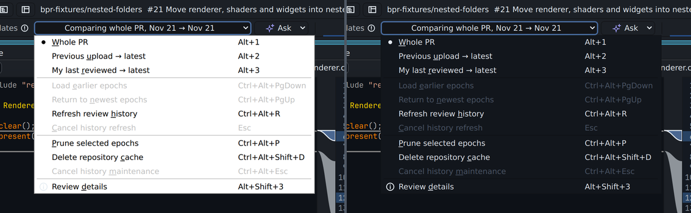

# Revision and Ask menus can open light with Appearance set to Dark

With BetterPullReview explicitly set to Dark, the Review workbench stayed dark on a light desktop, but the revision dropdown and the adjacent Ask menu opened with a white background and dark text. Running the same executable and profile with a dark desktop palette produced dark menus. The matching desktop and app settings hide this bug.

## Reproduce

1. Run the [released Linux build 76](https://github.com/MikeMarcin/BetterPullReview/releases/tag/0.5.0) with a light desktop palette. Set **Settings → Appearance** to **Dark**.
2. Open a pull request and switch to **Review**. Open the comparison dropdown above the diff. Dismiss it and open **Ask**.
3. Compare the background and text of both menus with the surrounding workbench.
4. Keep the same app profile and switch the desktop palette to dark. Relaunch and open the same menus again.

The release executable ran on an isolated Ubuntu 26.04 X11 display. The first capture used Qt's default light desktop palette. The second used a dark KDE palette. Both captures used the same pull request and the same explicit app appearance. This reproduces a dependency on the platform palette. A live palette change within one running process and the other platforms still need coverage.

## Expected behavior and acceptance

- **Dark** and **Light** each use the selected app theme for the workbench and its in-app popup menus, including their normal, selected and disabled items. A desktop theme change during the session preserves that choice when a menu is reopened.
- **System** resolves the app theme from the desktop appearance and applies it consistently to menus and the underlying workbench.
- Exercise both menus with explicit Dark on a light desktop and explicit Light on a dark desktop. Exercise System with each desktop appearance and after switching it. Include a check that opens the real popup, since a check limited to the parent widget misses the reported failure.

The [appearance contract](../../rfcs/RFC-BPR-0006-syntax-highlighting-themes-appearance.md) already specifies that only System responds to OS scheme changes.

## Cause

A popup menu is a top-level window, and Qt resolves a window's palette from
the application palette (the desktop's) rather than from its parent, unless
the window sets `Qt::WA_WindowPropagation`. `appearance_profile::apply_to`
sets the app's palette on the main window only, by design (it writes no
application palette). Every `QMenu` opened from the workbench therefore wore
the desktop's palette: offscreen and on xcb the application palette, on Cocoa
the theme's own menu palette. A handful of menus already worked around this
one by one (`WA_WindowPropagation` in the overview, generated files and
reviewer picker; an explicit full palette in the feedback label menu); the
Ask menu, the Comparing menu and most others did not. macOS had the same
defect: with Light chosen under the native look, the menus opened dark.

## Change

- `src/adapters/qt/src/popup_palette.{hpp,cpp}`: one application event
  filter, installed once by `appearance_profile::apply_to`. On each `Show` of
  a `Qt::Popup` window with a parent (a `QMenu`, a submenu) it copies the
  parent's palette with every role of every group set, before the first
  frame. A popup whose owner set a palette of its own (a combo box's list,
  the feedback label menu) keeps it; the filter's own palette is recognised
  and refreshed on every opening, so a desktop or app theme change during
  the session reaches the menu the next time it opens.
- `src/adapters/qt/AGENTS.md` records the rule next to the existing
  parentless-popup rule.

## Evidence (branch `claude/bpr-2356-popup-palette`, commit 13f2cb234, macOS, Debug; rebased on d91b84bd6)

`qt_popup_palette` (`tests/adapters_qt/popup_palette_tests.cpp`) sets the
desktop palette as the application palette, as the platform does, applies the
profile to a window holding the real `ask_menu_button` and the real
`epoch_comparison_control`, opens the real Ask and Comparing menus with
`QMenu::popup`, and reads every palette role in every group against the
opener's, the rendered ground, and the selected row's highlight in the grab.

| Criterion | Course | Result |
|---|---|---|
| Explicit Dark on a light desktop; normal, selected and disabled items | `test_explicit_modes_win_over_the_opposite_desktop` | pass |
| Explicit Light on a dark desktop | same | pass |
| Desktop changes during the session; explicit choice kept on reopen | same (light to dark to light, and back) | pass |
| System on each desktop appearance and after switching | `test_system_follows_the_desktop_and_its_switch` | pass |
| Real popup opened, not only the parent | every course grabs the shown `QMenu` | pass |
| Submenus follow; an owner's own popup palette stays | `test_submenus_follow_and_owner_palettes_stay` | pass |

- Negative control, with the `apply_to` hook removed: offscreen, every
  explicit-mode reading failed (for example "Dark on a light desktop,
  Comparing: the rendered menu is dark (dark share 0.000000)"), while System
  on a matching desktop passed, as the card observed. The in-test control
  `test_a_menu_takes_the_desktop_palette_without_the_profile` keeps that
  mechanism checked.
- Native look (`QT_QPA_PLATFORM=cocoa BPR_NATIVE_LOOK=1`,
  `BPR_NATIVE_LOOK_SCHEME=light` and `dark`, nothing on screen): pass with
  the fix; without it "Light on a dark desktop, Ask: the menu's ground is
  light" failed.
- `qt_appearance_profile`, `qt_ask_menu`, `qt_feedback_label_controls`,
  `qt_button_faces`, `qt_button_faces_cocoa`, `qt_appearance_settings_panel`,
  `qt_epoch_comparison_scale_100`, `architecture_boundaries`,
  `architecture_boundary_contract`: pass. Format and clang-tidy clean on the
  touched units. `verify_documentation.py`: `DOCUMENTATION_OK`.

Not exercised here: a real desktop theme switch on xcb or KDE, Windows, and
the owner's live macOS appearance change. The in-process switch is simulated
the way the platform delivers it (a new application palette, then the
app's observe-and-apply).
